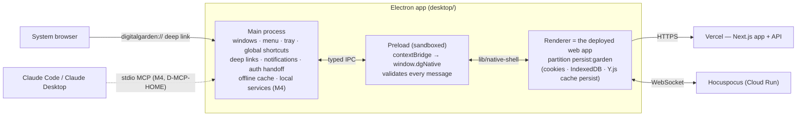

# Desktop App Plan

**Premise.** Digital Garden Desktop is the **web app, in a native window, with
the perks only a desktop app can offer**: OS-level hotkeys, a menu bar, real
windows, deep links, the file system, notifications, and working through a
dropped connection. Like `mobile/`, **nothing in the web app is reimplemented
natively.** The Next.js app stays the product. The shell adds capabilities
around it and exposes them to the web app through one typed bridge.

**North-star use case.** Hit a global hotkey from any app → a capture window
appears → type or paste → it lands in today's daily note. Later, open the laptop
on a plane and keep editing the notes you were working on. They sync when you
land.

---

## Founding decisions (resolved 2026-11-17 — do not re-litigate without owner)

- **D1 — Electron.** The app is built and tested against Chromium: Playwright
  visual regression, the Chrome extension, TipTap/contenteditable, Excalidraw,
  and Y.js. Electron ships that same engine, so there's no WebKit regression
  surface. Node in the main process makes the planned local services (MCP
  transport, vault mirror, file watching) plain TypeScript instead of Rust.
  *Accepted cost:* ~150 MB+ binary and higher memory than Tauri.

- **D2 — `desktop/` lives in this repo as an isolated package.** This mirrors
  `mobile/`. It has its own `package.json` and lockfile, is **not** a pnpm
  workspace member, and is excluded from the root `tsconfig.json` and
  `eslint.config.mjs`. Bridge changes on the web side and in the shell land in
  one PR. *Note:* Electron packaging and pnpm's symlinked `node_modules` don't
  mix by default, so use `node-linker=hoisted` in `desktop/.npmrc`, or npm as
  mobile does. (The standalone `Digital Garden Desktop` repo created during
  planning is no longer needed.)

- **D3 — Remote-first renderer; no bundled server.** The main window loads the
  **deployed origin** (or `http://localhost:3015` in dev) inside a persistent
  session partition (`persist:garden`). The Next.js server, Prisma, and every
  secret (DB URL, BYOK encryption key, provider keys) stay on Vercel.
  `output: "standalone"` exists, but bundling it would mean shipping secrets
  or standing up a local DB. That is out of scope until a full local-first
  milestone (not planned).

- **D4 — One native-shell bridge for both shells.** Generalize
  `lib/mobile-bridge/` → `lib/native-shell/`, with a transport-agnostic API
  (`postToNative`, `onNativeMessage`) and **capability detection**
  (`nativeShell.has("global-capture")`) instead of `isDesktop()` /
  `isMobile()` branches. Transports:
  - mobile: `window.ReactNativeWebView.postMessage`
  - desktop: `window.dgNative`, exposed by the preload via `contextBridge`

  The message union stays duplicated in each package, as today. A
  `native-shell:contract:check` gate (in the spirit of `shortcut-mirror:check`)
  fails the build when the copies drift.

- **D5 — macOS, owner-only, first.** Ad-hoc signed builds, no notarization, no
  auto-update until M5. Windows, Linux, and distribution to others are deferred,
  but nothing in M0–M4 may make them harder (no macOS-only APIs without a
  `process.platform` guard and a no-op fallback).

---

## Architecture



**Security posture (non-negotiable from M0).** `contextIsolation: true`,
`sandbox: true`, `nodeIntegration: false`. The preload exposes a *narrow typed*
API, not `ipcRenderer`. Every IPC payload is parsed like
`parseWebToNativeMessage`: unknown or malformed messages are dropped. The bridge
is exposed **only** when the top frame's origin is in the allowlist (prod origin,
`localhost:3015`). Iframes and navigations elsewhere get nothing.
`will-navigate` / `setWindowOpenHandler` enforce the navigation policy.
Off-origin links go to the system browser, except the OAuth hosts mobile already
learned must stay in-window.

### Proposed layout

```
desktop/
  package.json            # isolated; electron, electron-vite, electron-builder
  .npmrc                  # node-linker=hoisted (if pnpm)
  electron.vite.config.ts
  electron-builder.yml    # DMG, ad-hoc sign (M1); notarize + publish (M5)
  src/
    main/
      index.ts            # app lifecycle, single-instance lock
      windows.ts          # main window, pop-out windows, capture window; state persistence
      navigation.ts       # in-app vs system-browser vs new-window policy
      menu.ts             # native menu ↔ web command ids
      deep-links.ts       # digitalgarden:// routing
      auth-handoff.ts     # system-browser sign-in → cookie into persist:garden
      capture.ts          # global hotkey + capture window (M2)
      offline/            # M3
      services/           # M4: vault mirror, MCP transport
    preload/
      index.ts            # contextBridge → window.dgNative
    shared/
      messages.ts         # WebToNative / NativeToWeb (desktop variants) + parser
```

### Bridge contract additions (desktop)

| Direction | Message | Purpose |
|---|---|---|
| web→native | `web:set-title`, `web:open-external-url` | already in the mobile contract |
| web→native | `web:open-window` `{ contentId }` | pop a note into its own window |
| web→native | `web:notify` `{ title, body, deepLink }` | OS notification (AI run / workflow done) |
| web→native | `web:set-badge` `{ count }` | dock badge (pending reviews, unread) |
| web→native | `web:start-drag` `{ fileId }` | drag a garden file out to Finder |
| web→native | `web:register-commands` `{ commands[] }` | menu + accelerators mirror the web shortcut registry |
| native→web | `native:ready` `{ capabilities[] }` | capability handshake (D4) |
| native→web | `native:command` `{ id }` | a menu item or accelerator fired |
| native→web | `native:navigate` `{ path }` | deep link arrived |
| native→web | `native:connectivity` `{ online }` | authoritative online/offline signal |

---

## Auth (the riskiest seam)

Sessions are an httpOnly `session_token` cookie. Three paths, in order of
effort:

1. **In-window sign-in (M0 check).** Mobile found Google OAuth works inside a
   WebView. Electron's Chromium may instead trip Google's "this browser may not
   be secure" block. Email/password works either way, so for an owner-only M1
   this may be enough.
2. **System-browser handoff (M1, if path 1 is blocked).** This reuses the
   trusted-device model from the browser extension:
   1. Shell opens `https://<origin>/desktop/link?state=…&challenge=S256(verifier)`
      in the default browser, where Google sign-in works normally.
   2. Signed-in user confirms "Link this Mac". The server mints a short-lived,
      single-use code bound to the challenge, then redirects to
      `digitalgarden://auth/callback?code=…&state=…`.
   3. Main process POSTs `code + verifier` to `/api/auth/desktop/exchange` and
      receives a **device-scoped session**. It's revocable and listed next to
      trusted browsers in settings.
   4. Main writes it into `persist:garden` with `session.cookies.set`
      (httpOnly, secure) and loads the app.
3. **Reauth.** `google-reauth-client.ts` flows that pop windows must route
   through the same navigation policy. Inventory them during M0.

---

## Desktop perks — catalogue

| Perk | Why only desktop | Milestone |
|---|---|---|
| Native menu + browser-free shortcuts (⌘W, ⌘N, ⌘T, ⌘1…9 all belong to the app) | Browsers reserve these | M1 |
| Window state, single instance, Dock presence | — | M1 |
| `digitalgarden://open/<contentId>` deep links (from Calendar, Mail, Things, Raycast) | OS URL scheme | M1 |
| macOS polish: `hiddenInset` traffic lights + `-webkit-app-region: drag` header; **vibrancy under Liquid Glass surfaces** | Native window chrome | M1 |
| **Global quick-capture hotkey** → small always-on-top window → daily note | OS-wide hotkey | M2 |
| Menu bar (tray) item: capture, today's note, recent notes | — | M2 |
| Pop-out note windows / multi-monitor layouts | Real windows | M2 |
| OS notifications for AI runs, workflows, reminders, with deep-link back | Works when the tab isn't open | M2 |
| Drag files *out* to Finder (`webContents.startDrag`) | Browsers can only drag in | M2 |
| Progressive offline (see M3) | Owns the network + cache layer | M3 |
| Vault mirror: garden → Markdown folder on disk (Spotlight-searchable, Time Machine-backed, greppable by agents) | File system | M4 |
| Local MCP transport for Claude Code / Claude Desktop (D-MCP-HOME) | Local process, stdio | M4 |
| Local model reach (Ollama on `localhost`) (D-OLLAMA) | Vercel can't reach your localhost | M4 (spike) |
| Signed, notarized, auto-updating builds; Windows | Distribution | M5 |

---

## Milestones

### M0 — Spike: does the app survive Electron? (1–2 sessions)

Scaffold `desktop/` (electron-vite + TS). Load `localhost:3015` and prod in a
`persist:garden` window with the full security posture on. Run the mobile
README's four risk checks, plus three desktop-specific ones:

- [ ] Auth: email/password; **Google OAuth in-window** (decides whether the handoff is needed in M1)
- [ ] TipTap editing, slash menu, wiki-link autocomplete, IME/emoji input
- [ ] AI streaming + **resume after reload** (Upstash resumable streams)
- [ ] Uploads (two-phase presigned R2) + drag-in from Finder
- [ ] Hocuspocus WebSocket connects; two windows on one note show live presence
- [ ] Excalidraw + Mermaid blocks render and edit
- [ ] Quit → relaunch: still signed in; y-indexeddb docs still present

**Exit:** all checks pass or have a named fix. Write findings into this doc.

**M0 findings (2026-11-18):**
- **Shell + bridge work against prod.** `window.dgNative` is present on the app
  origin, absent on `accounts.google.com`, and no Node globals reach the page.
- **Launch at `/content`, not `/`.** `/` is the public site. `/content` is a
  protected prefix, so a signed-out launch flows to
  `/sign-in?from=/content` and back to the workspace.
- **Google did not UA-block Electron** (the UA still carries `Electron/45`; we
  deliberately don't spoof it). The flow reached Google's passkey challenge.
- **Passkeys do not work in-window (owner-verified 2026-11-18).** "Complete
  sign-in using your passkey" shows, but no OS prompt ever appears. Electron
  ships Chromium's content layer without Chrome's WebAuthn authenticator UI, so
  the credential request just hangs. Signing or entitlements can't fix it:
  platform passkeys are bound to the relying party's associated domain
  (`google.com`), which we don't control. **Decision: the system-browser
  handoff (§Auth path 2) is REQUIRED in M1**, not conditional. Until then,
  Google's "Try another way" (password / phone prompt) unblocks M0 testing.
- **Every other risk check passed (owner, 2026-11-18):** relaunch keeps the
  session; TipTap (slash menu, wiki-links, IME, paste, spellcheck); AI
  streaming + resume after reload; uploads incl. Finder drag-in; live
  collaboration across two windows; Excalidraw/Mermaid; mic for STT; external
  links → system browser. **M0 exit criteria met** except passkeys (→ M1 auth
  handoff).
- **Web bug surfaced, not desktop-specific: [#319](https://github.com/CenterValentine/Digital-Garden/issues/319).**
  Scroll jumps to the top when the collab transport sleeps/wakes, because
  provider presence is a `useEditor` dep, so the editor is recreated. Desktop
  makes it *more* visible (long-lived windows hit the 2-min solo cooldown and
  the visibility sleep constantly), so fix it before M1 dogfooding, or alongside.
- **`ELECTRON_RUN_AS_NODE=1` leaks from Electron hosts** (VS Code's extension
  host, and so Claude Code). Electron then runs as plain Node. The npm scripts
  clear it with `env -u`.
**Owner contribution:** the desktop `navigation.ts` policy (in-window vs system
browser vs new window). It's the same judgment call as mobile's
`shouldOpenExternally`, with a third option.

### M1 — Daily driver (owner replaces the browser tab)

- Navigation policy, single-instance lock, window-state persistence
- Auth: **system-browser handoff (required — M0 showed passkeys can't complete in Electron)**
- `lib/native-shell/` generalization (D4) + `native-shell:contract:check`
- Native menu wired to web command ids. The web shortcut registry yields
  conflicting accelerators to the shell when `nativeShell.has("menu")`.
- Deep links (`digitalgarden://open/…`), `hiddenInset` title bar + drag region
- `electron-builder` DMG, ad-hoc signed, built from a `pnpm desktop:build` script

**Exit:** owner uses the desktop app instead of the browser tab for a week.

### M2 — Native perks I

Global capture hotkey + capture window (posts to the existing capture API;
target = today's periodic note via `/api/periodic-notes/resolve`), menu bar
item, pop-out note windows, OS notifications (`web:notify`), dock badge,
drag-out to Finder.

### M3 — Progressive offline

The pieces already in place: Y.Docs persist per note in IndexedDB
(`dg:content:{id}`), the collab runtime has `localFallback` /
`disconnectedButDirty`, and bootstrap reconciliation
(`payloadIsNewerThanCollaborativeCopy`) heals divergence on reconnect.

**What's missing:**

1. **D-OFFLINE-SHELL — loading the app at all with no network.** The renderer
   is a remote origin, so offline means a blank window. Options:
   (a) a service worker in the web app, which advances M19 (PWA) and also helps
   browser users, but App Router RSC payloads are hard to cache correctly;
   (b) the main process records the last-good shell responses and serves them
   via `session.protocol.handle` / `webRequest` when offline;
   (c) a static "offline workspace" route. *Spike before committing.*
2. **Tree + metadata snapshot.** Cache the content tree, titles, tags, and the
   recent-notes list so navigation works offline.
3. **Scope rule.** Offline you can open and edit **notes you've opened before**.
   Structural ops (create, rename, move, delete) are queued with idempotency
   keys, or simply disabled offline in the first cut (owner's call at M3 start).
   AI, publishing, uploads, and non-note payloads show an explicit "needs
   connection" state.
4. **Status UI.** Online/offline + pending-changes indicator, driven by
   `native:connectivity`, not `navigator.onLine`.

**Exit:** airplane-mode test: edit 3 cached notes, reconnect, no duplicated
content (the "rival Y.Doc identity" failure in CONTENT-LOAD-CASCADE §9.4), and
no lost edits.

### M4 — Local integrations

- **Vault mirror (one-way first).** Main process writes the garden to a chosen
  folder as Markdown via the existing export converters, with `.meta.json`
  sidecars. Two-way sync is **blocked** on the known gap: no import consumer
  exists for sidecars, so round-trips lose tags and links.
- **D-MCP-HOME.** MCP interoperability is planned server-side (`mcp:prep`,
  `mcp:surface` gates exist). Desktop should be *a transport* for that server's
  tool surface (stdio ↔ authenticated HTTP using the device session), never a
  second tool registry.
- **D-OLLAMA (spike).** Can the main process serve as a local model endpoint
  the server routes to for this device? Likely needs a client-side execution
  path. Spike only.

### M5 — Distribution (only when wanted)

Apple Developer ID + notarization, `electron-updater` via GitHub Releases, a CI
release workflow on tag, crash reporting, then Windows (Azure Trusted Signing)
and Linux (AppImage).

---

## Web-side changes (kept deliberately small)

| Change | Milestone |
|---|---|
| `lib/mobile-bridge/` → `lib/native-shell/` with transports + capability detection | M1 |
| `/desktop/link` page + `/api/auth/desktop/exchange` + device sessions in settings (only if M0 needs it) | M1 |
| Shortcut registry: export command ids; yield accelerators to the shell | M1 |
| Desktop-aware header: drag region + traffic-light inset when `has("window-chrome")` | M1 |
| `web:notify` call sites (AI run complete, workflow complete) | M2 |
| Offline: tree snapshot endpoint/cache, connectivity-driven UI, queued structural ops | M3 |

---

## Non-goals

- **No native reimplementation** of any web feature.
- **No bundled Next.js server or local database** (D3).
- **Not an agentic-browsing execution surface.** AGENTIC-BROWSING-PLAN D1 makes
  the Chrome extension the only execution surface. Desktop's Chromium must not
  become a second one without the owner explicitly revisiting that decision.
- No Windows/Linux work before M5, and no macOS-only code without a guard (D5).

## Risks

| Risk | Mitigation |
|---|---|
| Google blocks OAuth in Electron | Email/password for M1; system-browser handoff |
| Offline shell loading is harder than it looks (RSC) | D-OFFLINE-SHELL spike before M3 commits |
| Shortcut conflicts between web registry and native menu | Single source: web registry exports ids; shell renders menu from it |
| Bridge contract drift across three copies (web, mobile, desktop) | `native-shell:contract:check` gate |
| Security: remote content + Node-capable shell | Sandbox + context isolation + origin-gated preload + validated IPC from M0 |
| Electron memory/binary size | Accepted (D1); revisit only if it bites daily use |
